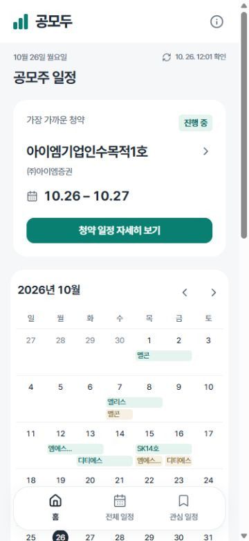
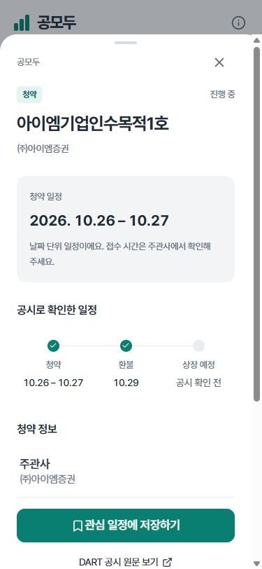

# 공모두 · Gongmodu

DART 증권신고서에서 확인한 공모주 청약 일정을 모아 보는 앱인토스 미니앱입니다. 공시 원문과 확인 시각을 함께 제공하며, 환불일·상장 예정일은 근거가 확인되는 경우에만 표시합니다.

**이번 출시 범위는 일정 조회입니다. 실시간 경쟁률·증권사 비교·배정 가정 계산은 보류했습니다.** 관련 연구와 코드는 보관하지만 출시 화면에서 불러오지 않고, 서버에서도 경쟁률 API를 제공하지 않습니다.

 

## 주요 기능

- 가장 가까운 청약을 먼저 보여주는 홈, 그다음 월간 달력과 다가오는 일정
- 달력 날짜 선택으로 바로 보는 일정과 월별 목록
- 종목명·주관 증권사 검색, 청약·환불·상장 필터, 스팩 제외
- DART 청약기일·인수인·모집가액과 공시 접수번호·정정 이력
- 공시 원문에 확인된 환불일·상장 예정일, 날짜별 근거 문구와 원문 링크
- 관심 일정의 기기 내 저장과 종료 일정 확인
- 토스 뒤로가기·홈·Safe Area 연동, TDS 버튼·정보 목록
- 마지막 정상 일정 유지, 실제 수집 날짜·시각 표시, 조회 오류 재시도

관심 저장은 자동 푸시 알림이 아닙니다. 청약 신청, 투자 권유, 수익 예측, 로그인·결제·광고는 제공하지 않습니다.

## 로컬 실행

Node.js **24 이상**과 npm을 사용합니다.

```powershell
npm ci
Copy-Item .env.example .env
# .env에 DART_API_KEY 입력 (서버 전용)
npm run sync:dart
npm run dev
```

[localhost:5173](http://localhost:5173)에서 앱을 확인합니다. API는 기본 3001 포트에서 실행되며 Vite가 `/api` 요청을 전달합니다. 수집은 `npm run sync:dart`로 명시적으로 실행합니다. API 요청은 수집을 시작하지 않으며, API에는 DART 키가 필요하지 않습니다.

| 환경 변수 | 용도 |
|---|---|
| `DART_API_KEY` | OpenDART 인증키. 서버에서만 사용하며 `VITE_` 접두어를 붙이지 않습니다. |
| `DART_SNAPSHOT_PATH` | 수집기와 API가 공유하는 일정 파일. 기본 `.cache/dart-schedule.json` |
| `DART_LOOKBACK_DAYS` | 최근 접수 공시 조회 기간. 기본 180일 |
| `VITE_API_BASE_URL` | 공개 API 기본 주소. 로컬은 빈 값, BlueCL은 `https://bluecl.cloud/gongmodu` |
| `PORT`, `HOST` | API 수신 주소. BlueCL은 `18824`, `127.0.0.1` |
| `ALLOWED_ORIGINS` | 허용할 토스 앱·테스트·웹 origin 목록 |

`.env`, 인증키, 캐시, `node_modules`, 생성된 `.ait` 파일은 Git에 포함하지 않습니다. 예시 환경 파일에는 빈 키만 둡니다.

캘린더 파일 내보내기는 토스 실기기 피드백에 따라 제거했습니다. 관련 과거 유틸리티와 테스트는 개발 이력으로만 보관합니다.

## 데이터 확인 원칙

OpenDART 공시 목록 → 지분증권 주요정보 → 공시 원문 → 같은 공모의 정정 전문을 차례로 확인합니다. 주관사가 요약 API에서 누락되면 같은 공시의 인수인 표로 보완합니다. 원문에 날짜가 없으면 환불일·상장일을 달력으로 추정하지 않습니다.

최신 정정이 변경 사항만 담고 있으면 같은 최초 제출일의 가장 최근 전문을 연결하고, 현재 청약 기간과 일치하는 근거만 사용합니다. 서로 다른 공모 회차나 정정 전 날짜는 섞지 않습니다. 미확인 값은 `null`로 유지하며, 출처·누락 안내를 화면에 표시합니다.

최근 180일의 접수 공시를 대상으로 하므로 모든 과거 IPO를 완전하게 수록한 데이터베이스는 아닙니다. 우분투 타이머가 한국 시간 0시·6시·12시·18시에 수집합니다. 앱은 저장된 결과만 조회하며 수집 중이거나 DART 장애가 발생해도 마지막 정상 일정과 실제 수집 시각을 유지합니다. 자세한 내용은 [DART 데이터 규칙](docs/DART-DATA.md)을 참고하세요.

## 구조와 API

```text
src/                    React/TDS 화면, 토스 플랫폼 연동
shared/schedule.ts      일정 모델, 달력, 날짜
server/dart/            OpenDART 요청, 공시 해석, 정정 검증
server/feed.ts          명시적 수집·검증 후 원자적 게시
server/snapshot.ts      수집과 분리된 스냅샷 읽기·마지막 정상 결과 유지
server/index.ts         읽기 전용 일정 API
tests/                  데이터 단위 테스트와 브라우저 사용자 흐름
deploy/bluecl/          전용 서비스 및 HTTPS 경로 설치 설정
docs/                   기획·설계·출처 조사·출시 기록
```

| 경로 | 내용 |
|---|---|
| `GET /api/health` | 프로세스 상태 |
| `GET /api/status` | 저장 데이터 유무·마지막 수집 시각·수집 주기. 키는 읽지 않음 |
| `GET /api/schedule` | 일정·마지막 수집 시각·출처·누락 범위 |

`server/competition.ts`, `shared/competition.ts`, `src/Competition.tsx`는 **보류 코드**입니다. 출시 앱은 이 화면을 import하지 않으며 `/api/competition`도 등록하지 않습니다. 기존 저장 내역을 보존하기 위해 기기 저장 키 `gongmoa:saved:v2`는 유지합니다.

## 검증과 빌드

```powershell
npm test
npm run test:e2e
npm run build:web
npm run build
```

브라우저 테스트는 설치된 Microsoft Edge를 사용합니다. 2026-10-26 기준 단위 테스트 35개, 모바일·데스크톱 흐름 20개가 통과했습니다. 조회만으로 수집을 시작하지 않는지, 실패 후 기존 데이터를 유지하는지, 상세 진입 시 로딩을 오류로 표시하지 않는지도 확인합니다.

앱 식별자는 콘솔과 동일한 `gongmodu`, 결과 파일은 `gongmodu.ait`입니다. 출시 빌드 전에 공개 HTTPS API를 설정해야 합니다. `npm run bundle:preview`는 API 설정 검사 없이 패키징하는 로컬 검토용 명령이며 출시 준비 완료를 의미하지 않습니다. 토스 실기기 테스트와 콘솔의 최종 검토는 별도 절차입니다.

디자인 점검과 공식 문서 적용 내용은 [UI/UX 점검](docs/UIUX-REVIEW.md)에 기록했습니다.

## 배포와 제출

API 배포 대상은 BlueCL이며 공개 경로는 `https://bluecl.cloud/gongmodu/api/schedule`입니다. 실제 반영 여부와 콘솔 제출 상태는 [출시 기록](docs/RELEASE.md)을 확인하세요. [BlueCL 배포 안내](deploy/bluecl/README.md)에 운영자 최초 설정, 검증, 복구 방법을 정리했습니다.

앱인토스의 금융 관련 서비스 정책은 최종 심사에서 확인해야 합니다. 유사 서비스 사례가 우리 앱의 승인을 보장하지는 않습니다. [입점 가능성·유사 서비스 조사](docs/ELIGIBILITY-RESEARCH.md)에 공식 정책과 사례를 구분했습니다.

## 기획·설계 문서

- [사례 분석, 기능 기획, UI/UX, 사용자 흐름](docs/PRODUCT-PLAN.md)
- [시스템 구조](docs/ARCHITECTURE.md)
- [DART 연동과 정정 공시 처리](docs/DART-DATA.md)
- [공모주 사이트 대조 검증](docs/DATA-VALIDATION.md)
- [경쟁률 조사와 계산 규칙 — 보류](docs/COMPETITION-DATA.md)
- [추가 증권사 공개 출처 조사 — 보류](docs/BROKER-SOURCE-RESEARCH.md)
- [디자인 검토와 검증 기록](docs/DESIGN-REVIEW.md)

초기 탐색 구조는 [Pingrow/2025_SEASONTHON_TEAM_55_FE](https://github.com/Pingrow/2025_SEASONTHON_TEAM_55_FE)를 참고했습니다. Flutter 코드·로고·이미지는 복제하지 않았으며, 초기 Google 캘린더 수집은 DART 기반 수집으로 교체했습니다. 별도 라이선스가 명시되기 전에는 이 저장소의 공개가 자유로운 재배포 허가를 뜻하지 않습니다.
